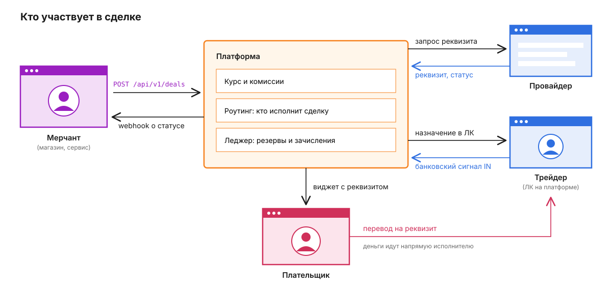
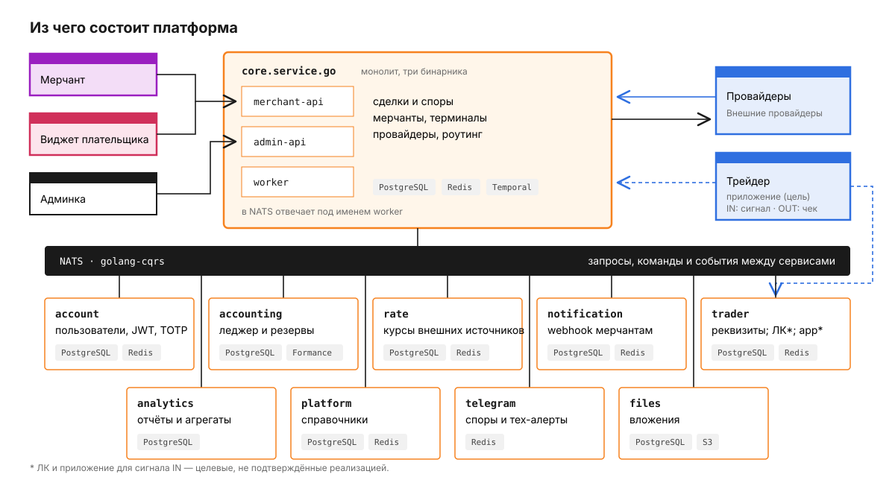

# Платёжная платформа

Платформа помогает мерчанту принимать входящие платежи (`IN`) и отправлять выплаты (`OUT`) в фиате. Она выбирает исполнителя — провайдера или трейдера, ведёт сделку, передаёт реквизиты, получает подтверждение результата и учитывает обязательства сторон. При `IN` плательщик переводит деньги **напрямую исполнителю**, а не на банковский счёт платформы. При `OUT` исполнитель переводит деньги получателю по реквизитам, которые мерчант передал платформе.



**Как читать этот репозиторий.** README объясняет работу платформы целиком. README сервисов подробно описывают документированное поведение существующих компонентов. Кабинеты трейдера и сотрудников, выплата через трейдера и внутренний криптоконтур — **целевые требования**, не утверждение об их реализации. Здесь только документация и схемы: исходного кода для проверки работающего backend нет. В публично описанном пути трейдер пока подтверждает `IN` через Telegram, а его manual-адаптер отклоняет `OUT`.

## Участники и два вида движения денег

| Участник | Что делает |
|---|---|
| Мерчант | Создаёт сделки через терминал/API, передаёт реквизиты получателя для `OUT`, получает статусы и ведёт споры |
| Плательщик / получатель | При `IN` платит исполнителю; при `OUT` получает от исполнителя фиат. Внутренний расчёт платформы ему не показывают |
| Провайдер / трейдер | Исполняет назначенную сделку. Провайдер работает через интеграцию и webhook; трейдер — через собственные реквизиты и операторский контур |
| Платформа | Выбирает исполнителя, фиксирует курс и комиссию, ведёт статусы, резервирует и проводит обязательства в леджере, отправляет мерчанту webhook |

Есть два **разных** слоя денег:

1. **Фиат сделки.** Плательщик переводит фиат исполнителю при `IN`, исполнитель — получателю при `OUT`. Результат этой операции определяет статус сделки. Чек и уведомление устройства — свидетельства, требующие соответствующей проверки, а не криптотранзакции.
2. **Внутренние расчёты.** Formance учитывает доступные остатки, резервы, комиссии и обязательства мерчанта, исполнителя и платформы. В целевой, пока не реализованной схеме пополнения и выводы между этими сторонами и платформой должны проходить в USDT TRC-20 под контролем адресов, KYT и казначейства. On-chain перевод сам по себе не подтверждает фиатную сделку и не создаёт права на доступный остаток без проверки и проводки. Игроку USDT как способ оплаты не предлагается.

Статус фиатной сделки, проверка чека, запись в леджере и статус перевода USDT — разные факты. Они связаны идентификаторами и сверкой, но не подменяют друг друга. [Системная спецификация криптоконтура](docs/platform-crypto-contour.md) описывает целевую схему для **всей** платформы, а не только трейдера.

## Входящий платёж: `IN`

Мерчант хочет принять, например, 5 000 RUB. У него есть терминал — точка интеграции с API-ключом, курсом, комиссиями и настройками маршрутизации.


1. Мерчант создаёт сделку. `core` фиксирует курс через `Rate.GetDealRate` и применяемую комиссию. Поле `merchantId` служит ключом идемпотентности; повтор запроса не создаёт вторую сделку.
2. Роутинг выбирает подходящего провайдера или трейдера из групп трафика терминала. Accounting резервирует сумму расчёта на доступном рабочем остатке выбранного исполнителя; если это трейдер, речь идёт о его **операционном** депозите, не о страховом. Выбранный исполнитель выдаёт реквизит, сделка становится `PENDING`, а мерчант получает ответ, в том числе `paymentLink`, если включён виджет. При параллельных попытках исполнителем становится только один кандидат; реквизиты остальных освобождаются.
3. Плательщик видит сумму и реквизит и переводит фиат напрямую исполнителю. Текущий провайдер подтверждает результат webhook. Целевое приложение на устройстве трейдера должно распознать банковское уведомление о зачислении и сопоставить его **с одной назначенной активной сделкой**; неоднозначные случаи разбираются в платформенном ЛК.
4. Подтверждение превращается в сигнал `payment-received` для `PaymentWaitWorkflow` в Temporal. Core проводит сделку через `PAID` в `COMPLETED`, accounting списывает резерв исполнителя и зачисляет мерчанту сумму за вычетом комиссии терминала; разница относится к выручке платформы. Notification отправляет мерчанту webhook. Если подтверждения нет до TTL, `IN` отменяется, а резерв освобождается.

Пример запроса, правила подписи и параметры merchant API описаны в [core](services/core.service.go/README.md#контракт-merchant-api) и [документации API](services/docs.service.react/README.md). Виджет — интерфейс фиатной сделки, не экран пополнения USDT.

## Исходящая выплата: `OUT`

Мерчант создаёт выплату и передаёт платформе реквизиты получателя. Core резервирует **расчётный остаток мерчанта**, а не страховой депозит трейдера. В текущем документированном пути выплату исполняет провайдер: он переводит фиат получателю, присылает webhook, и core проводит выплату. Действующий manual-адаптер трейдера `OUT` не принимает.

### Целевая выплата через трейдера

Платформа назначает выплату трейдеру и передаёт ему реквизиты только этой сделки. Трейдер переводит получателю фиат и прикладывает чек к ID сделки. Чек — документ о переводе, а не сам факт зачисления получателю; он попадает в очередь **чекера — сотрудника платформы**. Проверка подлинности PDF, если будет подключена, может помочь, но не заменяет человека и достаточные свидетельства исполнения.

Пока выплата в `PENDING`, чекер сверяет сумму, валюту, получателя, реквизиты и достаточные свидетельства исполнения. После допустимого подтверждения core переводит сделку в `COMPLETED`, accounting проводит расчёт один раз, notification отправляет webhook мерчанту. **Загрузка файла ничего из этого не запускает.** Если исход перевода неясен, резерв мерчанта остаётся до решения. Когда TTL истёк и сделка уже в `DISPUTE`, чекер передаёт заключение решающему оператору спора: обычное подтверждение из `PENDING` здесь применять нельзя. Назначение трейдера для `OUT`, критерии достаточного доказательства, отдельный расчёт с трейдером и серверные права чекера ещё требуют контракта и реализации.

[Кабинет трейдера](docs/trader-cabinet.md) описывает платформенное рабочее место, реквизиты и действия; [кабинеты мерчанта, саппорта, чекера и финансиста](docs/platform-cabinets.md) — другую сторону этой же операции. Это проектные спецификации, а не готовые страницы.

## Кто такие трейдеры

Трейдер и провайдер — два вида исполнителя. Оба входят в целевую модель `IN` и `OUT`, но различаются каналом исполнения и подтверждения. Провайдер интегрирован по API и webhook; трейдер работает с собственными банковскими реквизитами. Для `IN` целевое приложение трейдера считывает уведомления на его устройстве. Для `OUT` трейдер переводит фиат и передаёт чек на проверку платформе. Статус сделки и окончательные расчёты остаются у core/accounting, а не в приложении.

**Все рабочие действия трейдера — в ЛК на платформе.** Приложение на устройстве передаёт банковский сигнал `IN`, но не заменяет ЛК. Telegram — только чаты с саппортом/менеджером и бот уведомлений о назначенных сделках, операционном остатке и алертах; состав, пороги и получатели настраиваются в ЛК. Из Telegram нельзя подтверждать/отменять сделки, менять реквизиты или загружать чек. Бот не является источником статуса или баланса; актуальные данные и действия — в авторизованном ЛК.

### Два депозита трейдера

**Операционный депозит** обеспечивает повседневную работу и учитывается во внутреннем леджере. При `IN` из его доступной части резервируется сумма сделки. При целевом `OUT` трейдер отправляет фиат со своего банковского реквизита, а платформа резервирует расчётное обязательство мерчанта. Внутренний депозит не является банковским переводом получателю. Как учитывать операционную ликвидность трейдера и его расчёт по `OUT`, нужно утвердить; нельзя автоматически копировать правило резерва `IN`.

**Страховой депозит** — отдельное обеспечение. Его не учитывают как свободную ликвидность для роутинга, не резервируют под обычную сделку и не используют для выплат или комиссий. Если спор закрыт не в пользу трейдера, сначала покрывают обязательство из доступной операционной части; **только непокрытый остаток** можно взыскать из страхового по оформленному решению. Нехватка денег для новой сделки сама по себе такого права не даёт.

Возврат страхового возможен после завершения работы трейдера с платформой, истечения установленного периода ожидания после **последней транзакции** и при отсутствии открытых споров и непогашенных сумм. Срок вроде 30 дней — пример, не установленное правило. Раздельный страховой счёт и операции пока не описаны как реализованные в Formance; подробности — в [accounting](services/accounting.service.go/README.md#целевое-разделение-депозитов-трейдера).

## Расчёт по сделке и выбор исполнителя

На входящей сделке доход платформы — разница между списанием с исполнителя и зачислением мерчанту. Пример для 5 000 RUB при 100 RUB/USDT, комиссии исполнителя 3% и комиссии терминала 5%:

```text
расчётная сумма         5 000 / 100                       = 50,00 USDT
списание с исполнителя  50 × (100 − 3)%                  = 48,50 USDT
зачисление мерчанту     50 × (100 − 5)%                  = 47,50 USDT
разница платформы       48,50 − 47,50                   =  1,00 USDT
```

Это проводки **внутреннего леджера**, а не серия переводов USDT в блокчейне по каждой сделке. Если курс/актив сторон различается, используются зафиксированные в сделке условия и clearing; правила и расчёт в [accounting](services/accounting.service.go/README.md) и [rate-service](services/rate.service.go/README.md). Комиссии терминала и исполнителя могут зависеть от диапазона суммы. Роутинг исключает кандидата, который не подходит по направлению, методу, лимиту, доступному операционному остатку или экономике сделки.

### Кто исполнит сделку `IN`

Терминал связан с упорядоченными группами трафика. Роутинг проверяет группы и кандидатов, затем применяет выбранную стратегию: последовательно (`sequential`) либо параллельно по приоритету (`staged_race`) или по всей группе (`full_race`). При параллельной попытке резерв и реквизит должен закрепить один победитель, остальные освобождаются. Подробности приоритетов, комиссий и таймаутов — в [core](services/core.service.go/README.md). **Это описание маршрута входящего платежа:** в текущей реализации для выплат группы трафика не используются; выбор трейдера для будущего `OUT` ещё не определён.


## Почему у выплаты нет статуса PAID


`IN` проходит через внутренний, не видимый мерчанту `PAID` перед расчётом, затем в `COMPLETED`. У `OUT` нет промежуточного `PAID`: из `PENDING` она переходит в `COMPLETED` после подтверждения исполнения. Если срок выплаты истёк и её фиатный исход неизвестен, она попадает в бессрочный `DISPUTE`; резерв мерчанта сохраняется до ручного решения. Нельзя переносить на этот случай автоотмену входящего платежа или автоматическое закрытие обычного спора. После завершённой или отменённой сделки возможен отдельный спор по его правилам.

Мерчант видит в API четыре публичных статуса: `PENDING`, `COMPLETED`, `CANCELED`, `DISPUTE`. Внутренние `NEW`, `PENDING_REQ` и `PAID` отображаются как `PENDING`. Webhook отправляется для `COMPLETED`, `CANCELED` и `DISPUTE`; `PENDING` мерчант проверяет через API. Состояние «чек на проверке» не становится пятым публичным статусом. [Core](services/core.service.go/README.md) описывает переходы, таймеры и разбор споров подробнее.

## Кабинеты и ответственность

Существующая админка документирует доступ операторов (`admin`, `super_admin`, `support`, `analyst`), мерчантов (`merchant`, `merchant_owner`) и провайдеров (`provider_owner`). Новые экраны и полномочия нужно проверять и реализовывать на сервере, а не только скрывать в меню.

| Рабочее место | Главное действие в целевой модели |
|---|---|
| Мерчант | Свои проекты и терминалы, `IN`/`OUT`, споры, расчётный остаток и заявки на вывод |
| Трейдер | Назначенные сделки, реквизиты/устройства, подтверждение `IN`, фиатный перевод и чек по `OUT`, два депозита |
| Саппорт | Обращения и доказательства, коммуникация и эскалация; не завершает сделку и не правит проводки |
| Чекер | Проверяет чек и достаточное свидетельство фиатного `OUT` через трейдера; при споре передаёт заключение решающему оператору |
| Финансист | Остатки, заявки на расчёт, проводки и сверка; не заменяет решение чекера или Risk |

Права Risk, Treasury и Security для KYT, согласования вывода и подписи USDT разделяются. Ни `admin`, ни один финансист не должны единолично обойти риск-проверку и подписать свой вывод. Детальная [матрица кабинетов](docs/platform-cabinets.md) и [общеплатформенный криптоконтур](docs/platform-crypto-contour.md) показывают границы и нерешённые решения.

## Из чего состоит платформа



Core собран в три бинарника: `merchant-api` принимает запросы мерчанта/виджета и webhook провайдера, `admin-api` обслуживает кабинеты, `worker` исполняет фоновые процессы и CQRS-команды. Сервисы общаются через NATS с `golang-cqrs`; Temporal ждёт сигналов и TTL. Денежные проводки ведёт accounting в Formance. Core использует собственную доменную структуру, поэтому описание слоёв `go-clean-template` у остальных Go-сервисов не следует механически переносить на него.

| Компонент | Ответственность | Документация |
|---|---|---|
| `core.service.go` | Сделки, споры, мерчанты/терминалы, провайдеры, роутинг | [README](services/core.service.go/README.md) |
| `account.service.go` | Пользователи, аутентификация, роли и сессии | [README](services/account.service.go/README.md) |
| `accounting.service.go` | Остатки, резерв, расчёт и заявки; записи леджера в Formance | [README](services/accounting.service.go/README.md) |
| `rate.service.go` | Курсы для сделок | [README](services/rate.service.go/README.md) |
| `analytics.service.go` | Отчёты по сделкам и расчётам | [README](services/analytics.service.go/README.md) |
| `notification.service.go` | Webhook об исходе фиатной сделки | [README](services/notification.service.go/README.md) |
| `platform.service.go` | Справочники валют, методов и банков | [README](services/platform.service.go/README.md) |
| `trader.service.go` | Реквизиты `IN` и целевой трейдерский контур | [README](services/trader.service.go/README.md) |
| `telegram.service.go` | Споры провайдерам и технические алерты | [README](services/telegram.service.go/README.md) |
| `files.service.go` | Вложения сделок и споров | [README](services/files.service.go/README.md) |
| `golang-cqrs` | Транспорт сообщений поверх NATS | [README](services/golang-cqrs/README.md) |
| `admin.service.nuxt` | Кабинеты через браузер и BFF | [README](services/admin.service.nuxt/README.md) |
| `widget.service.nuxt` | Виджет фиатного `IN` | [README](services/widget.service.nuxt/README.md) |
| `docs.service.react` | Документация merchant API | [README](services/docs.service.react/README.md) |

Приложение трейдера, роли чекера/финансиста и USDT-оркестрация — **целевые** компоненты, не подтверждённые работающие сервисы. Криптоучёт ведётся по участнику и назначению остатка. Открытыми остаются управление ключами, поставщик и политика KYT, signer, план счетов и контракты с core/accounting. [Аудит документации](docs/documentation-audit.md) фиксирует устранённые расхождения и вопросы, которые нельзя закрыть редактурой.

## Об этой копии

Это документационная копия `payment_service` в приватном репозитории: README и схемы, **без исходного кода, тестов и развёртываемого стека**. Описания сервисов содержат сведения о полном проекте, но эта копия не позволяет запустить или проверить его. Чтобы подтвердить текущую реализацию, требуются приватный код, схемы Formance и интеграционные тесты. Целевые требования выше не являются отчётом о готовности платформы.
