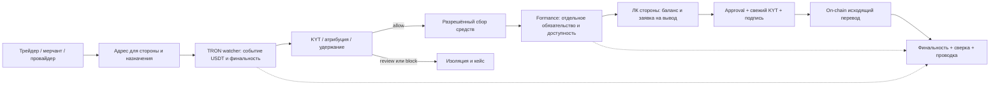

# Внутренний криптоконтур всей платёжной платформы

**Статус: целевая архитектурная спецификация, не реализованный сервис или действующий API.** Это расширение платформы, а не только [кабинета трейдера](trader-cabinet.md). Репозиторий содержит документацию и схемы без исходного кода; подтверждение совместимости с приватным backend, юридической схемой и Formance ещё необходимо. За основу взята согласованная для Silicon Souk рамка внутреннего TRON / USDT TRC‑20 контура; применение к **этой** платформе — новое проектное решение по запросу пользователя. Детали custody и собственного контракта из того проекта не становятся автоматически утверждённой реализацией здесь.

Пользовательские и операционные срезы для мерчанта, саппорта, чекера фиатных выплат и финансиста — в [спецификации кабинетов](platform-cabinets.md); чекер не выполняет KYT или казначейскую подпись.

## Границы продукта

- **Фиатный платёжный слой не меняется:** при `IN` игрок переводит фиат исполнителю (провайдеру или трейдеру); при `OUT` исполнитель переводит фиат получателю. Виджет и merchant API создают фиатные сделки и показывают их статусы. **Никакого USDT-адреса, кнопки криптооплаты или KYT-экрана для игрока.** Сигнал трейдерского устройства о фиатном зачислении не является событием блокчейна.
- **Внутренний расчётный слой охватывает всех участников:** трейдеры пополняют операционный и страховой депозиты, запрашивают разрешённые выводы; мерчанты пополняют расчётные остатки для выплат и получают расчёты/возвраты по договору; провайдеры пополняют рабочую ликвидность и получают расчёты; платформа хранит/контролирует расчётный актив, выполняет сверку и казначейские переводы. Допустимые направления, владельцы средств и встречные обязательства — только по соответствующим договорам. Страховой депозит **только трейдера** и никогда не часть доступной ликвидности маршрутизации.
- **Два разных факта:** подтверждённый on-chain перевод показывает перемещение USDT между адресами; внутренний Formance-леджер показывает права и обязательства трейдера, мерчанта, провайдера и платформы. Нельзя вывести обязательство из адреса без исторической привязки к стороне/договору или создать доступный баланс по одному неподтверждённому переводу. Перевод между собственными кошельками — перемещение актива, не вторая коммерческая операция.

## Потоки денег и связь с фиатными сделками

| Поток | Событие в криптоконтуре | Экономический смысл и отображение |
|---|---|---|
| Трейдер → платформа, **операционный** | USDT на адрес конкретного трейдера и назначения | После допуска и проводки увеличивает его рабочий баланс; `available/reserved` используется текущей логикой `IN` и целевой `OUT`. Не подтверждает отдельный фиатный `IN` |
| Трейдер → платформа, **страховой** | USDT на отдельное назначение | Отдельное обязательство и ограничения: не доступен роутингу/обычному выводу; использование только по закрытому против трейдера спору при отсутствии операционного депозита |
| Платформа → трейдер | Одобренный вывод операционного остатка либо договорный возврат страхового | Разные заявки, проверки и основания; страховой нельзя вывести через операционный путь |
| Мерчант → платформа | Договорное пополнение расчётного остатка | Финансирует **расчётный** баланс мерчанта/терминала по согласованному правилу; при фиатном `OUT` core отдельно резервирует его обязательство под сделку. Не является оплатой игрока |
| Платформа → мерчант | Одобренный вывод/settlement/возврат соответствующего обязательства | Не смешивать с merchant webhook об исходе отдельной фиатной сделки: `COMPLETED` сделки и on-chain выплата мерчанту — разные состояния и сроки |
| Провайдер → платформа | Пополнение его расчётной ликвидности | После допуска увеличивает только баланс этого провайдера. Проводки фиатной сделки по правилам accounting продолжают ссылаться на неё, а не на конкретный депозитный tx |
| Платформа → провайдер | Settlement/вывод по договору с провайдером | Отдельная заявка и своя сверка; не переименовывать в вывод трейдера |
| Казначейство, refund | Sweep между собственными адресами; разрешённый возврат удержанного поступления | Sweep не меняет коммерческого владельца. Refund требует отдельного риск/правового решения, не является отменой фиатной сделки |

Для каждой стороны показывать собственные суммы по заявкам/договорам/активу и ссылки на соответствующие сделки и проводки. Не вводить автоматический взаимозачёт между трейдером, мерчантом и провайдером или между юрлицами по сходству адресов, названий или валют. Курс `Rate.GetDealRate` для фиатной сделки остаётся **снимком её курса**; котировка/комиссия on-chain settlement — отдельная версия условий. Одна выплата USDT не переоткрывает фиатную сделку и не генерирует второй `COMPLETED` webhook.

## Сквозной путь: адрес → деньги → леджер → расчёт

1. **Адресный реестр.** Назначение адреса хранит юридическое лицо, тип и ID контрагента, проект/договор, `purpose` (например, trader-operational или trader-insurance), сеть и официальный token-contract, активную версию и историю ротаций. Для v1 предлагается изолированный адрес на связку стороны и назначения; постоянный адрес или адрес на заявку выбрать после правового/операционного анализа. Нельзя повторно закреплять адрес за другой стороной; retired-адрес наблюдать на поздние переводы. UI-таймер заявки не выключает приём средств блокчейном.
2. **Наблюдение и риск.** Проверить именно `Transfer` официального USDT TRC‑20, индекс лога, адреса, raw amount, блок и финальность; дедупликация по сети, хешу транзакции, индексу лога и контракту токена. Несколько событий в одной транзакции — отдельные поступления. После определения исторического владельца — KYT источника/операции; vendor timeout, неизвестный владелец, неверная сеть/токен или риск → `hold/suspense`, не `available`. Рискованный адрес исключить из чистого sweep; отправить назад автоматически нельзя.
3. **Кредитование и сбор.** Целевая v1-политика: доступный баланс только после финальности, доказанной атрибуции, KYT `allow` и подтверждённого контролируемого sweep в разрешённое хранилище. При смене политики gate остаётся явным и версионированным. Дебет/кредит Formance идемпотентны и указывают `chain_transfer_id`, `deposit_id`, назначение и юридическое лицо. Отдельно фиксировать состояние актива на адресе, транзит и обязательство перед участником; точный план счетов утверждают Finance/Legal. Существующие `Accounting.Ledger.TopUp` и `OperationRequest.*` — точки исследования интеграции, не готовый блокчейн-коннектор. Исправление неверного владельца — компенсирующие проводки с независимым одобрением, не редактирование старой записи и не новый on-chain перевод.
4. **Вывод/settlement.** Заявка привязана к стороне, договору, типу обязательства, свободному остатку, адресу и версии адреса. После бизнес-проверки — свежая KYT-проверка **каждого** исходящего поручения, заморозка реквизитов и суммы, раздельные approvals и подпись. `broadcast` не означает выплату: сверить receipt, фактический USDT Transfer, сумму, получателя, финальность, Formance и внешние основания. Повторять передачу **тех же** подписанных байтов при неопределённом ответе узла; новый tx только после доказанного исхода старого. После отправки нельзя обещать отмену транзакции. При возврате страхового дополнительно проверить закрытие договора, согласованный срок от последней транзакции и отсутствие споров/обязательств.
5. **Сверка.** По каждому переводу и на установленной отсечке сверять chain inventory по адресам/кошелькам, транзит, удержания, остатки и обязательства Formance по каждому типу стороны и юрлицу, затраты TRX/energy, комиссии и внешние отчёты. Необъяснимое расхождение создаёт кейс и блокирует затронутое движение по политике риска; до разбора нельзя «дотянуть» баланс молчаливой корректировкой.

## Состояния и права не смешивать

| Объект | Пример целевых этапов | Кто принимает решение |
|---|---|---|
| Фиатная сделка | `PENDING → COMPLETED` либо `DISPUTE` | `core`; у трейдера `OUT` — оператор после чека |
| Криптодепозит | обнаружен → ждёт финальности/атрибуции/KYT → удержан либо допущен → собран → доступен | наблюдение/KYT/Finance по политике; не клиентский Telegram-бот |
| Вывод USDT | создан → резерв → одобрение → KYT → подпись → отправлен → подтверждён → сверён | уполномоченные Finance/Risk/Treasury; не инициатор единолично |
| Спор/страховой депозит | открыт → решение против трейдера → проверка операционного остатка → документированное покрытие | core/оператор и Finance по разным полномочиям |

`notification.service.go` сегодня отправляет только webhook по статусу **фиатной сделки**. События KYT, депозита, settlement и chain-finality требуют отдельного контракта уведомлений, своей идемпотентности и политики раскрытия; в merchant deal webhook нельзя молча добавить новые статусы или чувствительные risk-данные.

## Слои платформы и интеграционные границы

| Слой / кабинет | Целевая ответственность; не существующий интерфейс |
|---|---|
| `core.service.go` | Владеет фиатными сделками, терминалами, провайдерами/трейдерами, договорным контекстом и полномочиями. Принимает **проверенное** событие доступного расчётного остатка, но не chain callback как подтверждение фиатного `IN`. Разделяет заявки на вывод и решение по выплате/спору |
| `accounting.service.go` + Formance | Единый источник внутреннего денежного учёта: рабочие `available/reserved`, отдельный страховой депозит трейдера, обязательства мерчантов и провайдеров по договорам, transit/hold и связь с on-chain inventory. Нет второго «криптобаланса» в приложении |
| Новый криптоконтур (проектный boundary) | Address Registry, TRON watcher с резервным чтением, KYT/case engine, custody/signer, sweep/refund, treasury и reconciliation. Хранит доказательства/состояния, а не параллельные коммерческие остатки; способ разбиения на сервисы и NATS/API-контракты утвердить после просмотра backend |
| `account.service.go` / `admin-api` | Удостоверяет сторону, роль и договорный scope. Отделяет инициатора, Risk, Finance, Treasury и Security; audit trail. Трейдер, мерчант и провайдер не читают чужие кошельки/кейс-доказательства |
| `admin.service.nuxt` | Кабинеты сторон: собственные адреса, движения, доступно/удержано, заявки и статусы; оператор платформы видит кейсы, Finance — ledger/reconciliation, Treasury — подписываемые поручения. Существующая provider/merchant UI не доказывает наличия этих страниц |
| `trader.service.go` + приложение | Устройство и фиатные реквизиты/чеки остаются отдельными от USDT-адресов. Кабинет трейдера показывает операционный и страховой контуры; источник остатков — accounting, источник tx-доказательств — криптоконтур |
| `rate.service.go` | Курс фиатной сделки не обновляется задним числом по on-chain цене; отдельно версионировать settlement FX/комиссию при необходимости |
| `analytics.service.go` | Deal-facts по фиатным сделкам остаются отдельно от криптодепозитов, withdrawal, сетевых комиссий и остатков; новые финансовые витрины строятся из проводок/сверки, без двойного подсчёта объёма и дохода |
| `notification.service.go` | Deal webhook без подмены; новый поток расчётных уведомлений только по утверждённому контракту и разрешённым полям. Player-facing виджет и `docs.service.react` не получают криптометод |

**Технический контракт — проект, не имена существующих обработчиков:** у заявок и событий нужны `operation_id`, idempotency key, version, correlation/causation, `legal_entity_id`, `counterparty_type/id`, назначение, сеть/token-contract и ссылки `chain event ↔ KYT ↔ approval ↔ journal`. Использовать outbox/inbox с дедупликацией и сериализацией по исходящему поручению/кошельку; timeout и повтор не должны приводить к второй подписи либо проводке. Никогда не передавать seed/private key в API, BFF, события и логи.

## Хранение и контроль средств — проектные решения, не утверждённый закупочный список

Депозитные адреса, риск-карантин, ограниченный рабочий кошелёк и отдельный резерв должны быть разделены так, чтобы не смешивать непроверенные поступления с допущенными. Пример Silicon Souk предлагает собственный минимальный казначейский смарт-контракт **после** KYT, холодный обычный TRON-адрес и аппаратный кворум; функция чужого референсного контракта неизвестна. Для `payment_service` необходимость собственного контракта, юридический держатель ключей и схема HSM/MPC/аппаратных подписантов остаются предметом решения. Контракт USDT, собственный контракт и обычный адрес — разные сущности; перевод USDT на контракт не вызывает сам собой метод «зачислить стороне». Если выбирается multi-signature, проверить Owner **и** Active permissions и практически подписать точный payload USDT в выбранном стеке; наличие нескольких аппаратных устройств или 2FA кабинета само по себе не создаёт криптографического кворума. Ограничить hot-ликвидность, отдельно учитывать TRX/energy, предусмотреть аварийную остановку и восстановление.

## Проверки до внедрения

- **Discovery:** карта юрлиц, договорных обязательств и потоков с трейдером, мерчантом и провайдером; счёт/формула операционного и страхового депозита; реальные схемы Formance и backend; роль каждого кошелька, лицензия/правовые ограничения, KYT-поставщик и политика возврата.
- **PoC:** историческое назначение адресов; TRC‑20 Transfer с двумя логами, late/reorg/duplicate, ошибочной атрибуцией и idempotent ledger credit; fail-closed KYT; безопасный sweep; точный USDT payout payload и закрытие bypass-пути подписей.
- **Пилот/приёмка:** пополнение каждого типа участника; отдельное страховое пополнение и запрет роутинга; расход `available` по фиатной сделке без двойного криптособытия; нормальный/удержанный/ошибочный вывод и refund; смена адреса после approval; недоступность KYT/узла/signer; расхождение chain ↔ Formance; отсутствие player-facing USDT и нового статуса фиатного webhook. Продакшен — только после заключений Legal, Finance, Risk и Security и сверки реального кода.

## Основание и нерешённое

- **Прямо задано для этой платформы:** фиатные `IN`/`OUT` через исполнителей и два депозита трейдера — [корневой README](../README.md#кто-такие-трейдеры), [trader-service](../services/trader.service.go/README.md), [accounting](../services/accounting.service.go/README.md). Пользователь отдельно потребовал привязать криптоконтур **ко всей** платформе.
- **Рамка из Silicon Souk, согласованная там, но не внедрённая здесь:** `/srv/obsidian/concepts/Silicon Souk/deliverables/crypto-contour/05-evidence-and-decisions.md` (внутренний USDT TRC‑20; собственная зона ответственности кошельков; неизвестные юрлицо/ключи/провайдер KYT). Разделение маршрутов и экранов — `01-product-and-money-flows.md`; custody/контракт как проект — `02-architecture-contract-custody.md`; состояния/леджер — `03-states-ledger-api.md`; риск и приёмка — `04-controls-operations-acceptance.md`.
- **Открыто:** юридический держатель и основание каждого направления; допустимость custody/лицензии; реальный план счетов и интеграция с Formance; адресная политика; KYT thresholds/vendor; сроки финальности; собственный контракт vs ограниченное хранилище; роли подписантов, лимиты, комиссии/FX и сроки settlements. В этой документации не утверждается, что названные сервисы или API уже существуют.
